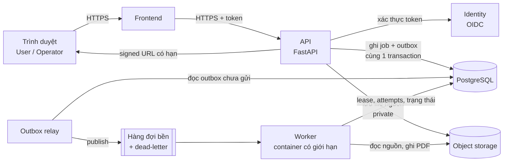
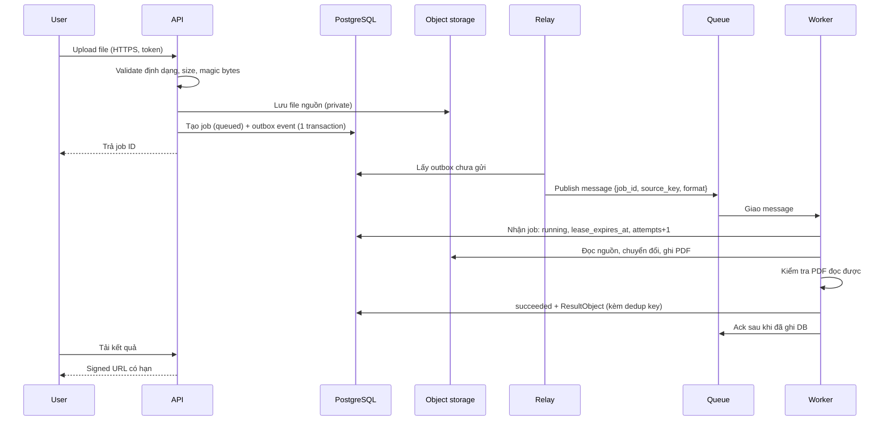
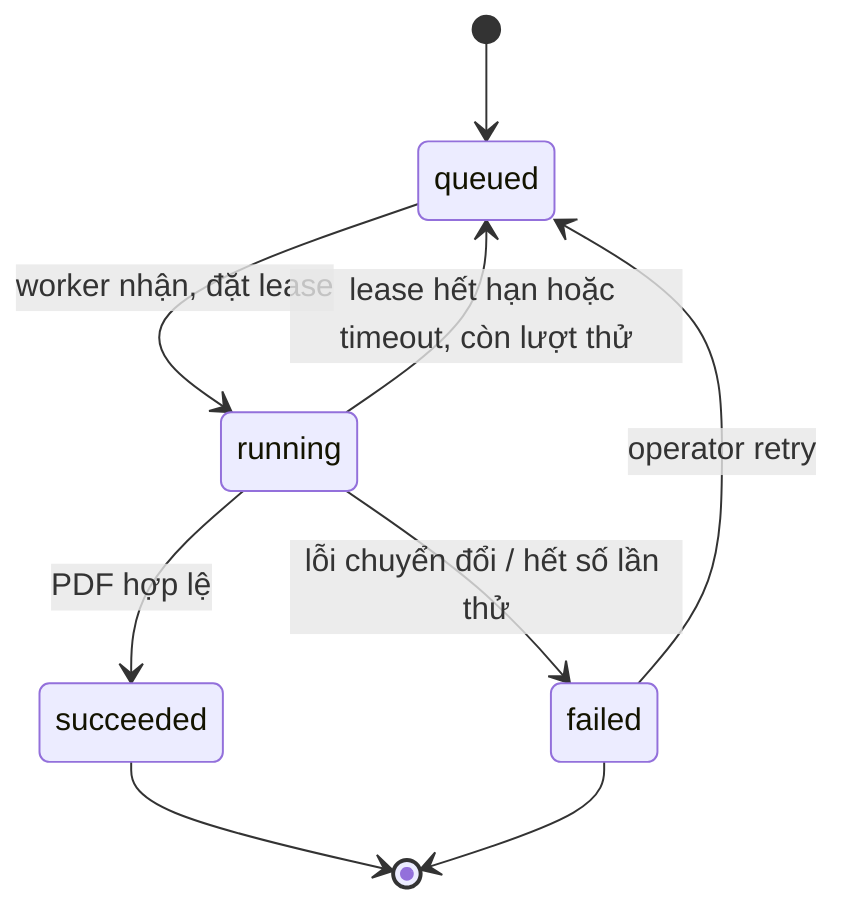

# Kiến trúc Doc2PDF (bản nháp logic)

> Bản nháp tuần 1. Tên dịch vụ cloud thật, đường mạng, ranh giới tin cậy và miền lỗi sẽ cập nhật khi chốt nền tảng.

## 1. Kiến trúc logic và ánh xạ dịch vụ

| Thành phần | Cục bộ (hiện tại) | Cloud (sẽ chọn) |
|---|---|---|
| Frontend / API | Docker, FastAPI | Cloud Run / ECS Fargate / App Service |
| Cơ sở dữ liệu | PostgreSQL 16 (container) | Cloud SQL / RDS / Azure DB for PostgreSQL |
| Object storage | SeaweedFS (S3) | Cloud Storage / S3 / Blob Storage |
| Hàng đợi | RabbitMQ | Pub/Sub / SQS / Service Bus |
| Đăng nhập | JWT giả | Identity Platform / Cognito / Entra External ID |
| Worker chuyển đổi | Container worker | Cloud Run Jobs / Fargate task / Container Apps Jobs |

Mọi truy cập storage, queue, auth đi qua lớp **adapter** (`Storage`, `Queue`, `Auth`) để đổi nền tảng bằng cấu hình.

## 2. Luồng chính (thành công)

## 3. Vòng đời job và phục hồi lỗi

| Tình huống | Cách xử lý |
|---|---|
| Message giao lại | Worker kiểm tra dedup key trong DB, bỏ qua nếu đã xử lý |
| Worker bị kill giữa chừng | Lease hết hạn, job quay lại `queued` hoặc `failed` nếu hết lượt thử |
| Chuyển đổi quá chậm | Timeout, dọn dữ liệu tạm, tính là một lần thử |
| Hết số lần thử | Job `failed`, message vào dead-letter, operator thấy và retry |

## 4. Việc còn lại để hoàn thiện bản chính thức

- [ ] Chốt nền tảng cloud và thay tên dịch vụ thật
- [ ] Vẽ đường mạng, ranh giới tin cậy (public/private), miền lỗi
- [ ] Ghi cách kết nối database riêng tư (VPC / connector)
- [ ] Thêm luồng giám sát: log có job ID, dashboard, alert
